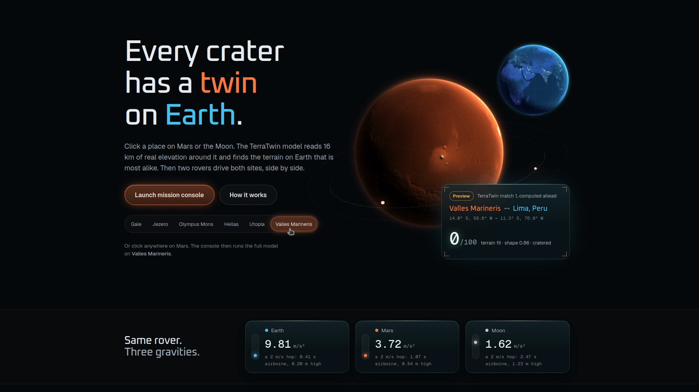
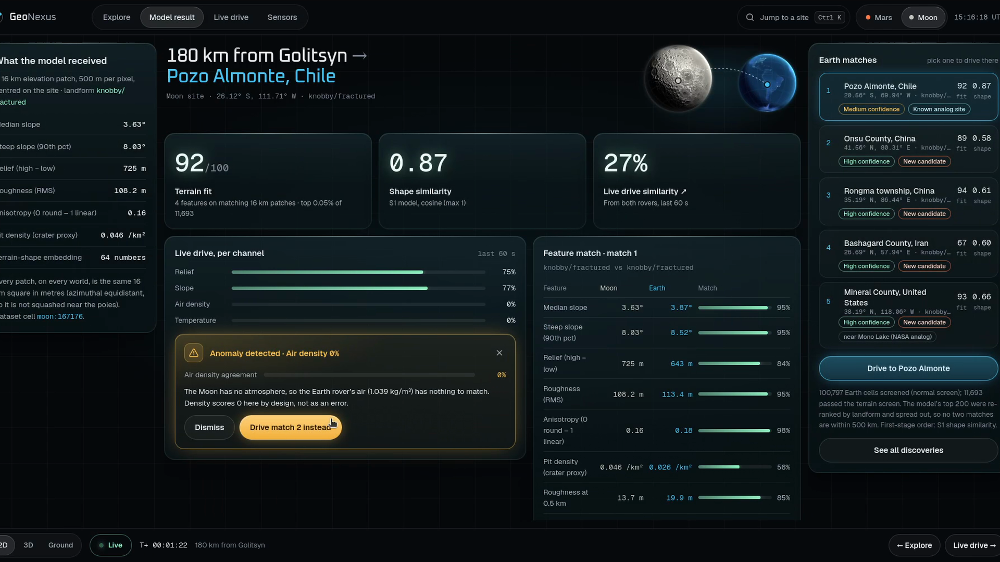
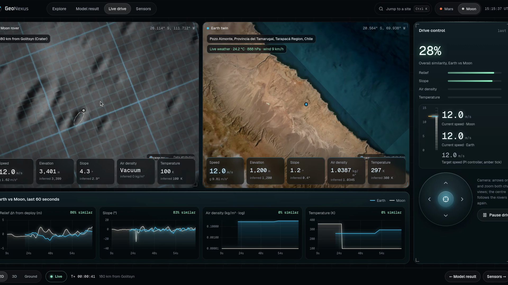
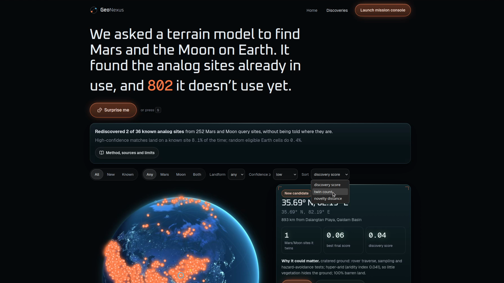

<div align="center">

# GeoNexus

### Find Mars and the Moon on Earth

Click any spot on the Moon or Mars. GeoNexus finds the places on Earth whose terrain looks most like it, explains why, and lets you drive a rover on both worlds side by side.

[](https://ikat5-geonexus.hf.space)
[](https://github.com/ikat5/mars_moon_earth_dataset)


Built by **Team G_SQUAD** for the **NASA Space Apps Challenge 2026**.

<br>



</div>

---

## Table of contents

- [Overview](#overview)
- [Screenshots](#screenshots)
- [Features](#features)
- [How the Earth-twin model works](#how-the-earth-twin-model-works)
- [Repository layout](#repository-layout)
- [Getting started](#getting-started)
- [Testing](#testing)
- [Deployment](#deployment)
- [Data sources](#data-sources)
- [Use of AI](#use-of-ai)
- [License](#license)

## Overview

GeoNexus reads 16 km of real elevation around any point on Mars or the Moon and ranks about 1.4 million Earth cells by how closely their terrain resembles it. Each result comes with a confidence level, a percentile and the measurements that agree. Two rovers can then drive both sites at once, under each world's own gravity, slope, atmosphere and temperature.

The same model was run over 252 Mars and Moon sites. Without being told where they are, it rediscovered 2 of the 36 known analog sites we checked against, and it surfaced 802 Earth candidate areas outside them.

## Screenshots

### Mission console: model result

The model returns five Earth twins for a chosen site, each with a confidence badge, a percentile and a feature-by-feature comparison. Here, a Moon site 180 km from Golitsyn matches Pozo Almonte, Chile, with a terrain fit of 92 out of 100.



### Live drive: two rovers, two worlds

The same rover drives the planet and its Earth twin at once. Charts compare relief, slope, air density and temperature over the last 60 seconds, with a per-channel similarity score.



### Discovery Atlas

252 Mars and Moon sites run through the model. Filter by novelty, world, landform and confidence, or use **Surprise me** (shortcut: **S**).



## Features

| Page | What you can do |
|---|---|
| `/` Landing | See the idea in one screen: Mars rendered from MOLA heights, its Earth twin, and a replay of a real rover drive at Gale crater |
| `/sim` Mission console | Pick a site on a 3D Mars or Moon globe (NASA MOLA / LOLA elevation, NASA Trek imagery). The model returns five Earth twins, each with a confidence badge, a percentile and the measurements that agree |
| `/sim/drive`, `/sim/sensors` | Drive the same rover on the planet and on its Earth twin at once, under each world's gravity, slope, atmosphere and temperature; live charts and a per-channel similarity score |
| `/discoveries` Discovery Atlas | 252 Mars and Moon sites run through the model: 871 Earth candidate areas, 802 outside the 36 published analog sites we checked against |

## How the Earth-twin model works

1. **Retrieve.** The S1 terrain encoder (a SimCLR model trained without labels on elevation patches) ranks about 1.4 million Earth cells from the integrated dataset. Physical screens keep dry, barren ground; polar sites use a cold-desert screen, then a labelled relaxation ladder so a query never comes back empty.
2. **Re-rank.** For the top 200 candidates, the same 16 km × 16 km patch at 500 m per pixel is cut on both worlds with an azimuthal-equidistant projection, so it stays square even at the poles. Landform descriptors (anisotropy, pit density, multi-scale roughness, curvature, landform class) re-rank the candidates.
3. **Pick and explain.** Five twins at least 500 km apart, each with its percentile among all eligible Earth cells, a confidence level and a comparison table.

All weights and thresholds are in `matching/config.py`, each with a comment.

> [!IMPORTANT]
> **Limits.** Scores are experimental terrain-resemblance indices, not proof of analog quality, safety or hardware performance. Features smaller than about 1 km (single dunes, for example) are below the 500 m resolution. Antarctica has no land-cover data, so polar matches rely on the relaxed screen, and the app says so.

## Repository layout

| Path | Contents |
|---|---|
| `src/` | React + TypeScript front end: `landing/`, `sim/` (console), `discoveries/` (atlas), `components/`, `styles/` |
| `js/` | Simulation core: physics, rover, DEM sampler, globe, labels, similarity, charts |
| `matching/` | Earth-twin pipeline: patches, landform features, screening and re-ranking, novelty, descriptor cache |
| `serve.py` | Python server: serves the built site (`dist/`), `/data/*`, the `/sim*` routes and `GET /api/analog` |
| `data/` | Small assets: Moon/Mars DEM PNGs, place-name labels, discovery atlas data, known analog sites (each with its source) |
| `scripts/` | Front-end build, data fetchers, atlas builder, evaluation, deploy helpers |
| `tests/` | `selfcheck.mjs` (rover, physics, poles), `test_matching.py`, `test_novelty.py` |
| `huggingface/` | Files for the Hugging Face Space that hosts the live app |
| `docs/screenshots/` | Images used in this README |

## Getting started

**Requirements:** Node 22.12 or newer, and Python 3.12 or newer.

```bash
npm ci
npm run build                       # builds the front end into dist/
python3 -m venv .venv
.venv/bin/pip install -r requirements.txt
.venv/bin/python serve.py           # http://localhost:8642
```

For front-end development, run `npm run dev` alongside `serve.py`; Vite proxies `/api` to it.

> [!NOTE]
> The Earth-twin search (`/api/analog`) needs the prepared dataset and the S1 index in `vendor/mars_moon_earth_dataset/`. Without them the site, the globes, the rover and the Discovery Atlas still work, and the API answers "Model unavailable". The live Space downloads them at start-up with `scripts/fetch_dataset_hf.py`.

## Testing

```bash
npm test                                   # rover, physics and pole crossing; atlas data
.venv/bin/python tests/test_matching.py    # patch geometry and landform descriptors
.venv/bin/python tests/test_novelty.py     # known / near-known / new site classification
```

## Deployment

The live app runs on [Hugging Face Spaces](https://ikat5-geonexus.hf.space). `huggingface/app.py` downloads this repository's `main` branch, builds the front end, fetches the dataset and starts `serve.py` on port 7860. To deploy a change, push to `main` and restart the Space.

## Data sources

**NASA:** LRO LOLA and MGS MOLA elevation (NASA PDS, USGS mosaics, NASA SVS), NASA Moon Trek and Mars Trek imagery, MRO CTX mosaic, LRO Diviner, GRAIL, Lunar Prospector, LROC pit locations, PGDA lunar illumination, Mars Odyssey GRS and neutron spectrometer, MODIS land cover, temperature and NDVI, VIIRS Black Marble (GIBS), and the USGS Terrestrial Analog Data Portal.

**Partners and others:** ESA Copernicus DEM, ESA WorldCover, Mars Express OMEGA, Mars Climate Database, ECMWF ERA5, NOAA ETOPO 2022, USGS geologic maps, dune databases and IAU place names, Robbins crater databases, Global Aridity Index, OpenLandMap, Natural Earth, Wikidata, AWS Terrain Tiles, Esri World Imagery, OpenStreetMap Nominatim and Open-Meteo.

Every dataset link, with citations and terms, is in the [dataset repository README](https://github.com/ikat5/mars_moon_earth_dataset). The 36 known analog sites in `data/known_analogs.json` each carry their own source link.

**Software:** CesiumJS, React, Vite, TypeScript, Tailwind CSS, shadcn/ui, Base UI, Chart.js, Motion, Lucide, Fontsource (Geist, Oxanium), NumPy, DuckDB, Rasterio, Pillow, PyTorch.

## Use of AI

Code and documentation were written with help from an AI coding assistant (Anthropic Claude, via Claude Code). All data, maps and imagery in the app are real and come from the sources above; none were generated by AI. The S1 terrain model is the team's own self-supervised model, trained on real elevation data.

## License

No license has been chosen yet for this code. Each data source keeps its own terms; see the dataset repository's `ATTRIBUTION.md`.
